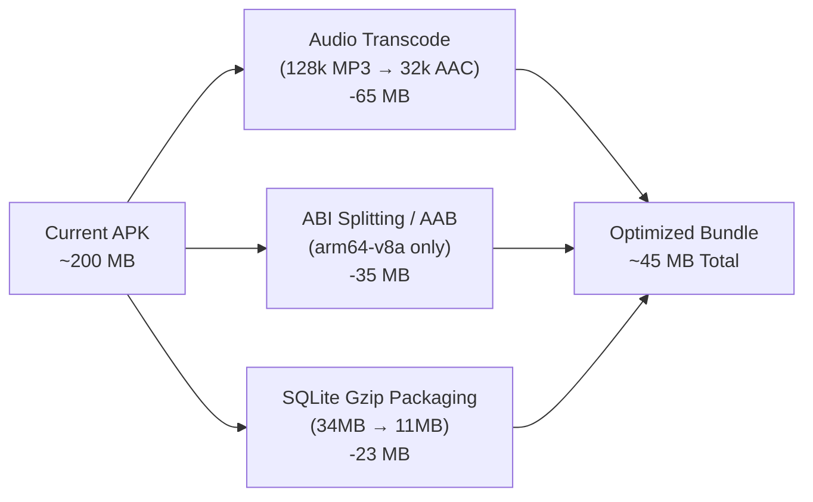
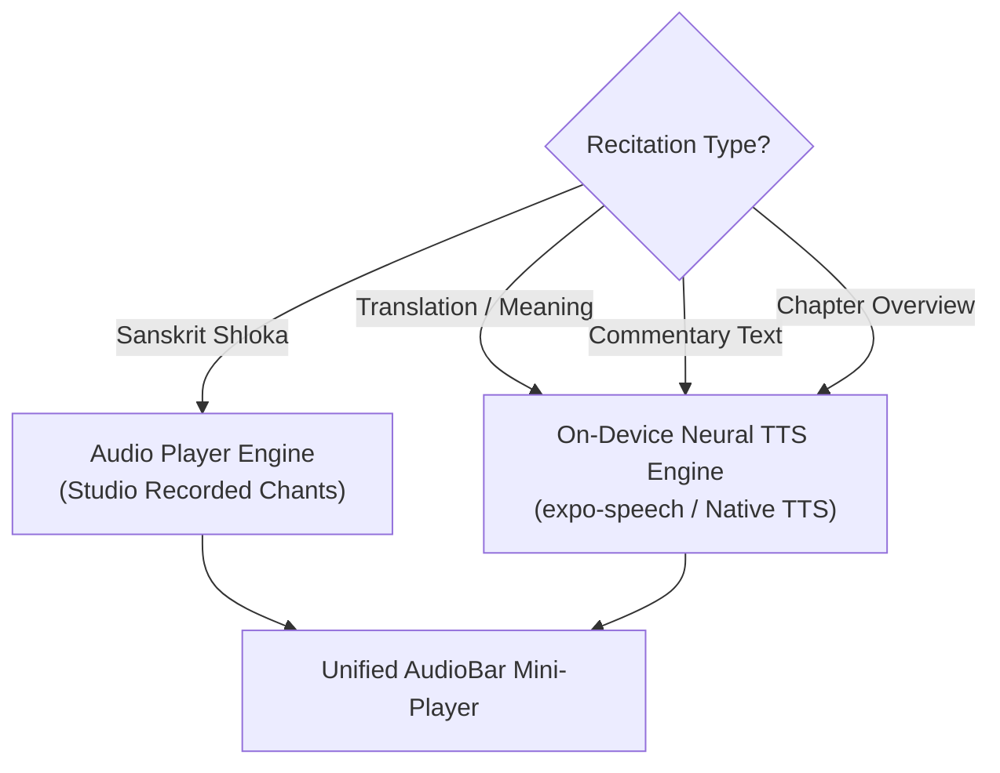
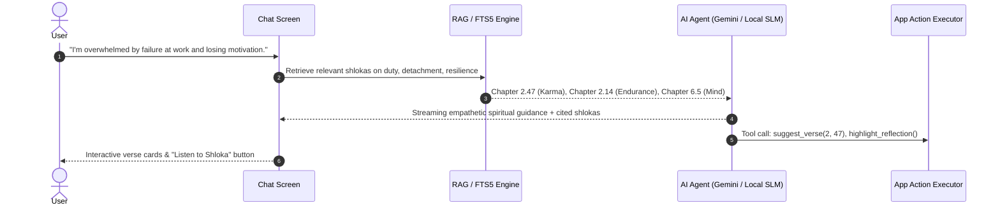
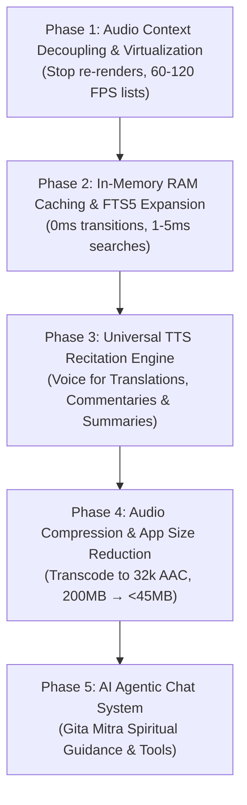

# Bhagavad Gita Mobile App — Architecture, Performance & Feature Evolution Plan

A comprehensive technical blueprint for optimizing the React Native / Expo application across performance, storage footprint, universal speech recitation, and an AI-powered spiritual guidance chat system.

---

## 1. Executive Summary & Target Metrics

| Dimension | Current State | Target Evolution | Projected Gain |
| :--- | :--- | :--- | :--- |
| **Download / APK Size** | ~200 MB (Fat APK, uncompressed audio & DB) | **~45 MB** (Bundled) or **~18 MB** (On-demand packs) | **75% – 90% size reduction** |
| **Audio Coverage** | Sanskrit Shlokas only (701 MP3s) | **Universal Recitation**: Sanskrit, Translations, Commentaries, Chapter Overviews | Complete voice coverage for **all 16,000+ texts** |
| **App Intelligence** | Static lookup & reading | **AI Agentic Chat**: RAG-based spiritual guidance for daily real-life challenges | Real-time life counseling with tool-calling actions |
| **Render Efficiency** | Continuous re-renders on audio playback ticks | Decoupled Context (`Control`, `Track`, `Progress`) | **95%+ render drop** during audio playback |
| **Search Latency** | FTS fallback to `LIKE %...%` (~250–600ms) | Comprehensive FTS5 indexing across translations | **1–5ms instant search (100x faster)** |
| **Screen Transitions** | SQLite queries on every navigation (~50–120ms) | In-memory JS RAM cache for static scripture | **0ms instantaneous screen transitions** |
| **List Virtualization** | Unbounded FlatList re-renders on 78-verse chapters | Item memoization + viewport pruning | **Silky 60–120 FPS** scrolling & lower RAM usage |

---

## 2. Radical App Download Size Reduction (200MB → < 45MB)

### Breakdown of Current 200MB Size
1. **701 MP3 Audio Files**: ~90 MB (128–160 kbps stereo).
2. **SQLite Database**: ~34 MB uncompressed.
3. **Universal Fat APK Overheads**: ~50–60 MB containing 4 native architecture ABIs (`arm64-v8a`, `armeabi-v7a`, `x86`, `x86_64`).
4. **Icons, Fonts & Framework Runtimes**: ~15 MB.

### Multi-Pronged Reduction Architecture



#### 1. Audio Transcoding (Immediate ~65 MB Savings)
- Sanskrit recitation is monophonic solo human voice chanting without instrumental orchestration.
- Transcode all 701 MP3s to **32 kbps mono AAC-LC (`.m4a`) or Opus**:
  ```bash
  ffmpeg -i input.mp3 -ac 1 -b:a 32k -c:a aac output.m4a
  ```
- **Result**: Audio footprint shrinks from **90 MB to ~24 MB (~73% reduction)** with zero perceptible degradation in chant clarity.

#### 2. Android App Bundle (AAB) & ABI Splitting (Saves ~35 MB)
- Configure `eas.json` or Gradle to produce Android App Bundles (`.aab`) and ABI-specific APKs.
- Google Play delivers only the device's native architecture (e.g. `arm64-v8a`), cutting ~35 MB of unused `.so` libraries.

#### 3. Database Packaging with Gzip/Brotli (Saves ~23 MB)
- Bundle `gita.db` as `gita.db.gz` inside the app bundle.
- Size drops from **34 MB to ~11 MB**.
- On first launch, the app decompresses the database into internal storage via `expo-file-system` and removes the compressed archive.

#### 4. Optional: Dynamic On-Demand Audio Packs (< 20 MB Base APK)
- Ship core app with Chapter 1 & 2 pre-bundled (~5 MB).
- Provide a clean in-app **"Download Chapter Audio"** or **"Download Complete Recitation Library"** manager that pulls remaining chapters in the background.

---

## 3. Universal Speech Recitation Architecture

Currently, audio playback is restricted to the 701 Sanskrit shlokas. The app will be enhanced to support audio recitations for:
1. **Shloka Translations** (English & Hindi)
2. **Commentaries** (Ramanuja, Shankaracharya, Swami Sivananda, Prabhupada, etc.)
3. **Chapter Overviews & Summaries**



### The 0 MB Storage Solution: On-Device Speech Synthesis (TTS)
- **Problem**: Pre-recording audio for 4,907 translations and 11,186 commentaries would take **over 6 GB of audio files**, making offline bundling impossible.
- **Solution**: Use on-device Text-to-Speech via `expo-speech` and Android's native neural TTS engine (`android.speech.tts.TextToSpeech`):
  - **Storage Cost**: **0 MB added to download size**.
  - **100% Offline**: Leverages Google TTS / Samsung TTS models already installed on the user's phone.
  - **Natural Multi-lingual Support**:
    - Hindi: `hi-IN` (natural Devanagari voice).
    - English: `en-IN` / `en-US` (clear, articulate pronunciation).
  - **Playback Features**:
    - Speed control (`0.8x`, `1.0x`, `1.2x`, `1.5x`).
    - Pitch adjustment for a calm, meditative listening cadence.
    - Seamless pause/resume integrated with the floating `AudioBar`.

---

## 4. AI Agentic Spiritual Guidance Chat System

An interactive AI spiritual companion ("*Gita Mitra*") providing personalized wisdom, counseling, and practical life applications grounded in the verses of the Bhagavad Gita.



### Key Capabilities

#### 1. Real-Life Problem Mapping
Users enter modern personal dilemmas:
- Career anxiety & fear of outcomes (*Karma Yoga — Ch. 2 & 3*).
- Dealing with anger, grief, or emotional turbulence (*Controlling the Gunas — Ch. 14*).
- Relationship dilemmas & righteous action (*Dharma — Ch. 2 & 18*).
- Calming a restless mind & meditation (*Dhyana Yoga — Ch. 6*).

#### 2. Hybrid AI Engine (Cloud + Offline Local)
- **Cloud Mode (Default)**: Powered by Google Gemini 2.5 Flash / Groq for rapid, deep, and empathetic philosophical reasoning (< 1.5s latency).
- **On-Device / Offline Mode (Optional)**: Support for lightweight on-device Small Language Models (e.g., ExecuTorch / MediaPipe with Gemma-2B or Qwen-2.5-0.5B) for complete air-gapped privacy.

#### 3. Agentic Tool Calling (Actionable Integration)
The AI agent is equipped with app tools:
- `open_verse(chapter, verse)`: Navigates the user directly to the detailed verse reader.
- `play_shloka(chapter, verse)`: Starts immediate audio recitation.
- `bookmark_verse(verse_id)`: Saves recommended verses to the user's spiritual collection.
- `search_topics(query)`: Pulls cross-referenced verses into the conversation.

#### 4. Spiritual Persona Guardrails
- Respectful, compassionate, non-judgmental tone.
- Directly quotes authentic Sanskrit shlokas and accredited translations.
- Distinguishes philosophical guidance from medical/clinical advice.

---

## 5. Performance & Rendering Optimization Pillars

### Pillar 1: Decouple Audio Playback Context
- **Issue**: Updating playback `position` multiple times/sec causes cascade re-renders of `HomeScreen`, `ChapterScreen`, and `VerseScreen`.
- **Fix**: Split into `AudioControlContext` (static functions), `AudioTrackContext` (current verse/status), and `AudioProgressContext` (consumed only by progress line).

### Pillar 2: Expand SQLite FTS5 Search
- Index all 4,907 translations in `verses_fts`.
- Apply `PRAGMA cache_size = -3000;`, `PRAGMA mmap_size = 30000000;`, and `PRAGMA temp_store = MEMORY;`.
- Search response drops from **~400ms to 1–5ms**.

### Pillar 3: In-Memory Static Scripture Caching
- RAM cache for chapters, verses, and commentaries in `db.ts` for **0ms instantaneous navigation**.

### Pillar 4: FlatList Virtualization & Memoization
- Item memoization (`React.memo`) and viewport pruning (`initialNumToRender={10}`, `windowSize={5}`, `removeClippedSubviews={true}`) for **60–120 FPS scrolling** on long chapters.

---

## 6. Phased Implementation Roadmap



| Phase | Milestone | Focus Areas |
| :--- | :--- | :--- |
| **Phase 1** | **UI Rendering Performance** | Split `AudioContext`, memoize verse cards, configure FlatList virtualization. |
| **Phase 2** | **Query & Screen Acceleration** | In-memory RAM cache in `db.ts`, expand SQLite FTS5 for translations, SQLite PRAGMAs. |
| **Phase 3** | **Universal Recitation (TTS)** | Integrate `expo-speech` for English & Hindi translations, commentaries, and chapter summaries. |
| **Phase 4** | **Download Size Reduction** | Batch transcode 701 audio files to 32 kbps mono AAC-LC; configure ABI-split packaging. |
| **Phase 5** | **AI Agentic Chat Companion** | Build RAG context retriever, chat interface, Gemini API streaming, and tool execution. |

---

## 7. Verification & Benchmarking Checklist

- [ ] **Bundle Size**: Verify production APK / AAB size is **< 45 MB** (down from ~200 MB).
- [ ] **TTS Recitation**: Verify offline speech synthesis for Hindi & English translations and commentaries.
- [ ] **AI Chat Accuracy**: Benchmark AI responses to cite correct chapter/verse references and execute action tools.
- [ ] **Render Profiling**: Verify 0 re-renders on `HomeScreen` and `ChapterScreen` during active audio playback.
- [ ] **Search Latency**: Confirm search queries complete in **< 10ms** across all 18 chapters.
- [ ] **Scroll Performance**: Verify smooth 60/120 FPS scrolling on Chapter 18 (78 verses).
